<p align="center">
  
</p>

Software engineer working on reverse engineering and low-level development, mostly in C and C++ on Windows and Linux.

## Focus

| Area | Details |
|:--|:--|
| Reverse engineering | Static and dynamic analysis of native binaries, protection and obfuscation analysis |
| Low-level development | C, C++ and Assembly; Windows internals and the PE format |
| Tooling and automation | Utilities, bots and internal services in C++ and C |

## Stack

| Category | Technologies |
|:--|:--|
| Languages | C, C++, Assembly |
| Analysis | IDA Pro, Ghidra, x64dbg |
| Platforms | Linux (Arch, KDE Plasma), Windows |
| Infrastructure | QEMU/KVM |

## Activity

<!--START_SECTION:stats-->
```text
┌─[ Language distribution ]────────────────────┐
│ C++         [######################]   80.5% │
│ С           [##....................]   11%   │
│ Shell       [#.....................]   8.5%  │
│ Other       [##....................]   2.6%  │
└──────────────────────────────────────────────┘
```

| Metric | Value | Note |
|:--|--:|:--|
| Contributions | **400** | last 12 months |
| Repositories | **45** | 17 public / 28 private |
| Languages | **18** | 14.6 MB of source analysed |
| Primary language | **C++** | 31% of all code |

<sub>Generated from the GitHub API, last updated 2026-10-27 13:09 UTC.</sub>
<!--END_SECTION:stats-->

<p align="center">
  
</p>
